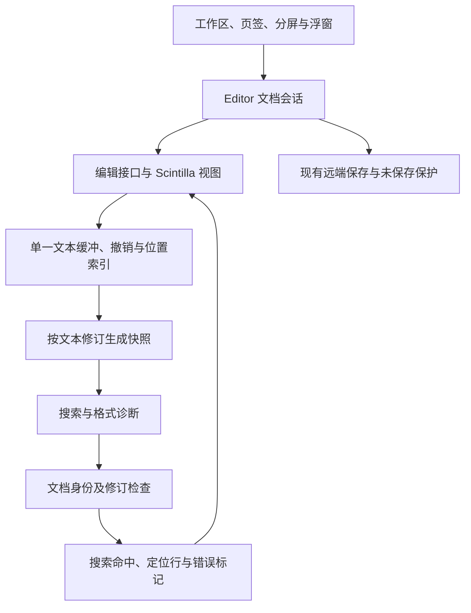

# 编辑器拖选卡顿调查与重构方案

日期：2026-11-13。基线：FrogShell 0.1.46，提交 `b135487e1371120aad834ee541b9c37f20c500d2`。

本次由主线程独立调查，没有交给 Terra 或其他子代理。调查在本地隔离程序中进行，没有连接服务器、读取凭证或修改用户文件。本文记录方案和原型结果，**不表示正式版已经解决拖选卡顿**。

## 1. 决策

优先采用 **Qt 界面外壳 + Scintilla C++ 编辑内核**，以官方 `ScintillaEditBase` Qt 接口作为迁移起点。先将文档身份、搜索、诊断、保存与编辑控件解耦，再接入现有功能。继续使用 Qt 构建服务器工作区，不引入浏览器运行时。

用户在同一个隔离测试窗口中实际拖选后反馈：右侧 Scintilla 明显流畅，左侧当前编辑器明显卡顿。这为迁移方向提供了实际交互依据。该原型的右侧尚未接入完整语法着色、查找、诊断和文本无障碍接口；迁移完成后必须重新验收，不能将裸控件表现视为完整产品表现。

## 2. 已确认的路径与边界

| 发现 | 依据与含义 |
| --- | --- |
| 卡顿可以脱离服务器复现 | 本地样例、相同 Qt 进程、同窗口左右对照也存在差异，SSH 和文件传输不是复现该问题的必要条件 |
| 离屏测试不足以评价桌面拖选 | 普通文件在 offscreen 下的鼠标和绘制函数通常不足 1 ms；真实 Windows 窗口中仍观察到约 80～140 ms 的更新间隔 |
| Windows 辅助功能通知是已捕获的耗时路径 | 自身 UI 线程采样包含 `QWidgetTextControl::selectionChanged → QAccessible::updateAccessibility → UiaRaiseAutomationEvent`，以及 UI Automation/COM 等待；原生 Qt 对照也会出现 |
| 单个 mouseMove/paint 的耗时不能代表整个响应时间 | 函数本身很快时，等待仍可能发生在平台事件处理、通知和两个绘制之间 |
| 长中文行滚动还有排版绘制成本 | 当前控件、原生 Qt 和 Scintilla Qt 接口在压力样例中均出现过慢绘制；原生 DirectWrite 后端与 Qt 后端表现不同 |
| 之前的搜索样式修复只覆盖局部 | 普通文件未打开查找也会卡顿，减少搜索样式切换不能解释全部问题 |

这些证据确认了具体的阻塞路径，尚不能证明所有用户停顿都来自同一调用。没有将内存分配、服务器刷新、Qt 的所有版本或所有平台笼统认定为原因。

早期所谓“原生 Qt”对照混入了自定义行距布局，不能据此排除行距布局；本次已另建完全原生 `QPlainTextEdit` 对照。

## 3. 尝试过的方案

| 方案 | 结果与处理 |
| --- | --- |
| 原生布局、自定义布局、当前 CodeEdit 交叉对照 | 避免将自定义功能与平台行为混为一谈；未发现仅撤掉行距就能消除全部停顿的依据 |
| 仅在测试进程临时静默辅助功能通知 | 常见输入间隔和鼠标处理耗时下降，但仍有长尾；用于定位，不进入产品 |
| 以 32 ms 合并选区/光标辅助功能通知 | 通知次数减少，长尾反而恶化；否决，不进入产品 |
| Scintilla Windows DirectWrite 原型 | 选区计算明显更轻，热身后的滚动样例较稳定；首次绘制曾出现约 245 ms 耗时，不能只报热身数据 |
| Scintilla Windows GDI 原型 | 本轮两侧均出现大量慢帧，部分压力用例触及测试截止时间；不用于宣称提升幅度，也不据此选择 GDI |
| Scintilla 官方 Qt 接口 | 已独立编译并展示。中文绘制与真实鼠标拖选可工作，用户明确确认右侧更流畅；尚未完成完整编辑器能力验收 |

Qt 6.8.3 与查阅的 6.10.1 Windows 辅助功能通知入口没有消除上述同步分发路径的实质变化。未构建完整新版本 Qt 作性能对照，因此不将“升级 Qt”当作已验证的修复。

Scintilla Windows 原型没有提供与 Qt 等价的完整文本辅助功能接口，Qt 原型也没有接入文本专用适配器。**禁止通过全局关闭 Qt 无障碍支持来获得表面上的流畅度。** 迁移时明确编辑区的辅助功能支持范围，并单独验证文本适配和通知策略；窗口、菜单、按钮等仍使用正常 Qt 机制。

## 4. 重构边界



### 4.1 文档与视图接口

保留 `Editor` 对外承担文件路径、修改状态、保存、关闭保护和工作区归属。增加编辑表面接口，工作区和搜索控制器通过接口操作文档、选区、定位及装饰，不再依赖 `QPlainTextEdit`、`QTextDocument` 或 `QTextCursor`。

接口覆盖：读取快照、范围替换、撤销事务、只读、修订号、选区、行列定位、居中显示、主题、字体、缩放、搜索装饰和诊断装饰。使用稳定文档 ID、服务器/路径身份及本次打开的实例标识，防止旧异步结果写到重新打开的同路径文档。

每份文档只有一份权威文本缓冲。**不在后台维护一份隐藏的完整 QTextDocument 来兼容旧接口。** 快照只为保存、查找和诊断等实际工作生成，不因鼠标移动、选区变化或重画生成。

### 4.2 输入、排版和装饰

由编辑内核负责光标、字符命中测试、选区、撤销、滚动、行布局和局部重画。手势路径中不做全文扫描、文件 I/O、解析、样式表重设或同步等待后台任务。

通过内核的词法样式、indicator、marker、选区和当前行机制分别呈现语法颜色、普通搜索命中、当前命中、当前定位行、手动选区及错误波浪线。分别管理生命周期和绘制优先级；清空/关闭查找只清对应装饰及其拥有的选区。

保留字体、字重、中文回退、用户确认的行距和应用整体缩放。使用内核支持的行高参数，移除通过修改 `QTextLine` 几何来增加行距的路径。布局缓存按可视区域和预算约束，关闭视图后释放，不为改善一次测试无上限缓存全文布局。

### 4.3 搜索与位置映射

当前 `src/core/documentsearch.h` 约定 UTF-16 位置，`DocumentSearchController` 保存 `QTextCursor` 锚点；Scintilla 使用 UTF-8 字节位置。迁移中必须显式区分两种坐标，禁止把数字直接互传。

建立按行维护、局部更新的 UTF-16/UTF-8 索引；处理中文、emoji/代理对、组合字符、Tab、CRLF 与文末。搜索结果携带文档 ID 和文本修订号。编辑后的命中和锚点按增删事件更新，重叠修改则使相应命中失效，不能跳到旧偏移。

保留 Ctrl+F 查找替换、大小写/全字/正则、保留大小写替换，以及高级搜索结果唯一面板、跨页签保留记录、重新打开来源文件和定位居中等行为。

### 4.4 诊断、保存与生命周期

继续沿用后台格式校验，结果通过文档 ID、修订号和范围检查后才显示。搜索与诊断不会从鼠标事件中同步启动；无文本变化时不重新解析。关闭视图或切换来源后，过期结果不会重新挂回装饰。

保持现有远端写入策略、未保存关闭提示及断线保护；编辑内核替换不改变服务器操作规则。验证原有文件编码、换行和 BOM 行为，避免迁移时发生内容转换。多文件分屏、页签重排和独立窗口继续由现有 Qt 外壳管理。

## 5. 实施顺序与验收门槛

1. **已完成：** 定位平台路径、建立原生 Qt/当前控件/Scintilla 隔离原型，获得用户实际左右对照反馈。
2. **下一步：** 先补齐 Scintilla 原型的语法着色、搜索背景、定位行和错误红线，以相同内容、字体、行距和状态复测；明确文本辅助功能适配，验证中文输入法与键盘操作。
3. 抽取文档会话和编辑接口，迁移搜索坐标、锚点与异步修订守卫，再接工作区的保存、分屏和浮窗。
4. 完成真实窗口拖选与功能回归，验证内存预算后，才能进入正式版本。首轮未通过不发布“已修复”的更新。

建议以当前 Windows 主机、60 Hz 显示为首个固定验收环境：持续同屏反复拖选、跨行反选、反向跨锚点、边缘自动滚动；覆盖普通中文文件、长行、多行、搜索开启/关闭和语法错误状态。以至少三轮、热身与首次交互分开记录。

性能目标是**选区实际变化的输入到首次对应绘制** p95 不超过约 16.7 ms、p99 不超过约 33 ms，不再出现可复现的 100 ms 级停顿；最大值和失败轮次也必须报告。上述是下一阶段验收目标，尚不是原型的达标结论。空闲或选区未变化时不要求重画，不能将它们算成丢帧。

Qt 和 Scintilla 的现有合成驱动、样式数量、字体回退及辅助功能不完全等价。`paint_interval` 只是两次绘制间隔，可能包含无须重画的输入，**不能直接换算为真实帧率或鼠标到屏幕的延迟**。单次测试中的处理函数 p95、平均值，也不能作为整个应用“提升百分之多少”的结论。

功能验收至少包含：中文输入法预编辑与提交、中文/英文/emoji 混合选区、撤销重做、搜索替换、保存重开、只读、错误红线、两套主题、字号及整体缩放、多文件分屏与独立窗口、关闭后取消异步回写。Windows 验证不能替代 Linux/macOS 验证，跨平台构建及输入验证属于迁移交付条件。

内存采用相同文档和相同进程起点的独立对照，包含打开多个文件、反复打开关闭、搜索结束、空闲后的私有内存及对象存活。当前原型同进程依次加载不同后端，`private_bytes` 包含前序缓存，**不用于后端内存排名**。

## 6. 本地证据及复现

调查目录：`test-results/selection-investigation-20261113/`，构建配置为 MSVC v143 Release、Qt 6.8.3。现有编辑器链接冻结的 0.1.46 库。

| 文件 | 用途 |
| --- | --- |
| `probe.cpp`、`CMakeLists.txt` | 原生/自定义布局对照、事件计时与自身线程栈采样 |
| `offscreen-native-ab.json`、`windows-native-ab.json` | 离屏与 Windows 平台对照 |
| `windows-stacks-wide.json` | 包含可读符号的 UI Automation 调用栈；采样会干扰耗时，只用于定位 |
| `windows-dispatch.json` | 鼠标、绘制、输入法查询及慢事件分发记录 |
| `windows-a11y-muted-confirmed.json` | 已确认构建后的测试进程静默通知对照 |
| `windows-a11y-coalesced.json` | 已否决的合并通知实验 |
| `engine_comparison.cpp`、`windows-engine-abba.json` | Windows 原生 DirectWrite 原型与 ABBA 顺序记录 |
| `windows-engine-gdi-abba.json` | GDI 探索记录，包含截止时间影响，不能据此宣称收益 |
| `qt_engine_comparison.cpp`、`windows-qt-engine-abba.json` | 官方 Qt 接口原型、选区确实发生变化的记录 |

早期的 `windows-a11y-muted.json` 与构建结束次序存在疑点，不作为有效结论。符号被截断的早期栈记录也不用来识别具体函数。

Scintilla 5.5.7 来自官方 `https://www.scintilla.org/scintilla557.zip`，SHA-256：`801faef6a2404ec4cbe6f22c853d9bb63fc5e18f169f302a9c69b9d6f93349dd`。采用官方许可及 Qt 接口，不能与许可不同的 QScintilla 包混淆。Qt 原型另使用隔离目录中的 Qt 6.8.3 Core5Compat 模块，没有修改项目正式 Qt 安装。

构建两个主要原型：

```powershell
cmake -S test-results/selection-investigation-20261113 -B test-results/selection-investigation-20261113/build -G "Visual Studio 18 2026" -A x64 -T v143 -DCMAKE_PREFIX_PATH="$PWD/.tools/Qt/6.8.3/msvc2022_64"
cmake --build test-results/selection-investigation-20261113/build --config Release --target selection_investigation qt_engine_comparison --parallel 4
```

运行需将项目 Qt、OpenSSL 和调查目录 `qt5compat/bin` 加入当前子进程 PATH，设置 `QT_PLUGIN_PATH` 为项目 Qt plugins。`QT_QPA_PLATFORM=windows`；`PROBE_OUTPUT` 指定 JSON 输出；`PROBE_VARIANTS`/`PROBE_SCENARIOS` 控制 Qt 对照，`ENGINE_SCENARIOS` 控制内核对照。`--interactive` 启动离线左右对照窗口。正式计时与桌面截图检查分开执行，避免 UI 自动化观察本身改变测量条件。

以上记录对应内核迁移前的调查阶段。用户随后批准使用右侧官方 Scintilla Qt 方案，实施及验收记录见 [Scintilla 编辑器迁移](editor-scintilla-migration.zh-CN.md)。调查阶段没有发布新版本。
